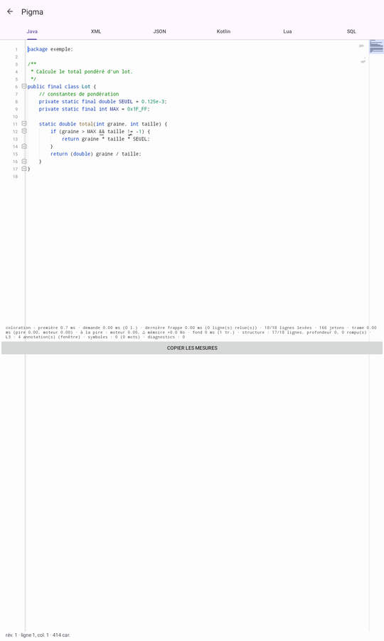

# Pigma en 5 minutes

Un éditeur de code embarquable pour Android : coloration
incrémentale multi-langages, plis, recherche/remplacement, minimap,
complétion sans serveur, et un client LSP complet quand vous en
avez un. Ce guide part d'un projet vide et va jusqu'au serveur de
langage — chaque extrait se copie tel quel.



*L'écran de démonstration (le module `:sample` du dépôt) : la vue
posée dans un écran Material, la gouttière, les onglets de langages,
la feuille de mesures.*

## 1. La dépendance (une seule)

`settings.gradle.kts` :

```kotlin
dependencyResolutionManagement {
    repositories {
        google()
        mavenCentral()
    }
}
include(":editor") // ou votre inclusion du projet
```

`build.gradle.kts` de l'application hôte :

```kotlin
dependencies {
    // TOUT y vit : le tampon, la coloration, l'annotateur et le
    // client LSP sont exposés en api par la bibliothèque
    implementation(project(":editor"))
}
```

La bibliothèque demande `minSdk 26` et `compileSdk 35`. Java 17.
Aucune autre dépendance à déclarer — Material n'est nécessaire qu'aux
écrans qui l'utilisent déjà.

## 2. La vue (deux lignes)

```java
import jo.pigma.editor.EditorView;

EditorView editor = new EditorView(this);   // l'activité
setContentView(editor);                     // ou addView dans votre layout
```

La vue démarre vide et prend tout seul le focus, le clavier et le
toucher. `editor.getBuffer()` expose le tampon (`TextBuffer`),
`editor.getUndoStack()` l'annulation (vos boutons « Annuler » y
branchent `undo()`/`redo()`, `canUndo()`/`canRedo()`).

## 3. Le langage et le contenu

```java
import jo.pigma.syntax.Languages;
import jo.pigma.editor.EditorThemes;

// un langage parmi JAVA, XML, JSON, KOTLIN, LUA, SQL
editor.setLanguage(Languages.JAVA, "package demo;\n\nclass Hello {\n}\n");
```

La coloration part immédiatement : les premières lignes se
colorent à la première trame, le reste part en fil de fond par
tranches annulables (un fichier de 52 000 lignes ouvre en ~12 ms,
le fond finit sans bloquer l'interface). Lire le texte :
`editor.getBuffer().toString()`.

## 4. Le thème

```java
// six thèmes prêts, fond assorti
editor.applyTheme(EditorThemes.DARK, EditorThemes.DARK_BACKGROUND);
editor.applyTheme(EditorThemes.LIGHT, EditorThemes.LIGHT_BACKGROUND);
// SOLAR, FOREST, OCEAN, COFFEE aussi prêts
```

La bascule ne re-lexe RIEN : les jetons restent, seules les
encres changent (mesurée : aucune retokenisation).

## 5. Le serveur de langage (facultatif, trois lignes)

La façade `LspEditor` câble TOUT à votre place — la synchronisation
du document, le survol, la complétion, la signature, les
diagnostics, le renommage, le formatage :

```java
import jo.pigma.editor.lsp.LspEditor;

LspEditor lsp = LspEditor.attach(editor);

// en processus (votre serveur Java — un serveur de démonstration
// vit au sample) :
lsp.connectInProcess(new MonServeur(), "file:///doc.java", "java");

// ou par processus externe (jar, binaire natif) :
// lsp.connectProcess(process, "file:///doc.lua", "lua");
```

Chaque fonction se coupe individuellement (`setHoverEnabled(false)`,
`setCompletionEnabled(false)`, `setSignatureHelpEnabled(false)`,
`setDiagnosticsEnabled(false)`), l'état de la connexion parle à un
écouteur (`setConnectionListener`), et `lsp.disconnect()` coupe
proprement. Sans serveur, l'éditeur vit déjà : complétion par
mots-clés et symboles du document, diagnostics d'appariement des
signes, plis, guides de blocs.

## Ce que vous avez déjà, sans rien brancher

- **Coloration L1/L2/L3** : lexeurs JFlex (Java, XML, JSON, Kotlin,
  Lua, SQL), pliage de blocs, annotateur sémantique Java.
- **L'édition** : annulation/rétablissement groupé, sélection au
  doigt avec poignées et loupe, double-tap au mot, traîné-déposé,
  copier/couper/coller par la barre de sélection.
- **La navigation** : gouttière (numéros, marqueurs de diagnostic,
  points d'arrêt), minimap avec pastilles annuler/rétablir,
  recherche/remplacement (feuille basse), aller-à la ligne.
- **Le clavier** : connexion IME complète (composition, accents,
  claviers par événements), complétion qui survit à la frappe,
  signature des appels, documentation au survol.
- **Les thèmes hôtes** : `setPopupStyle(PopupStyle.builder()...)`
  règle l'apparence des popups ; la gouttière, les guides et la
  minimap suivent le thème posé.

## L'écran de démonstration

Le module `:sample` du dépôt montre tout, câblé dans un écran
Material réel : onglets de six langages, tiroir de thèmes, feuille
basse de mesures, serveur LSP de démonstration en processus,
serveur Lua natif par processus. `./gradlew :sample:assembleDebug`
produit l'APK à installer.

## En cas de doute

- `docs/ARCHITECTURE.md` — les six modules et leurs invariants.
- `docs/chantiers/` — le journal des fonctionnalités, chantier par
  chantier (63 chantiers documentés).
- `ROADMAP.md` — ce qui est fait, ce qui vient.
